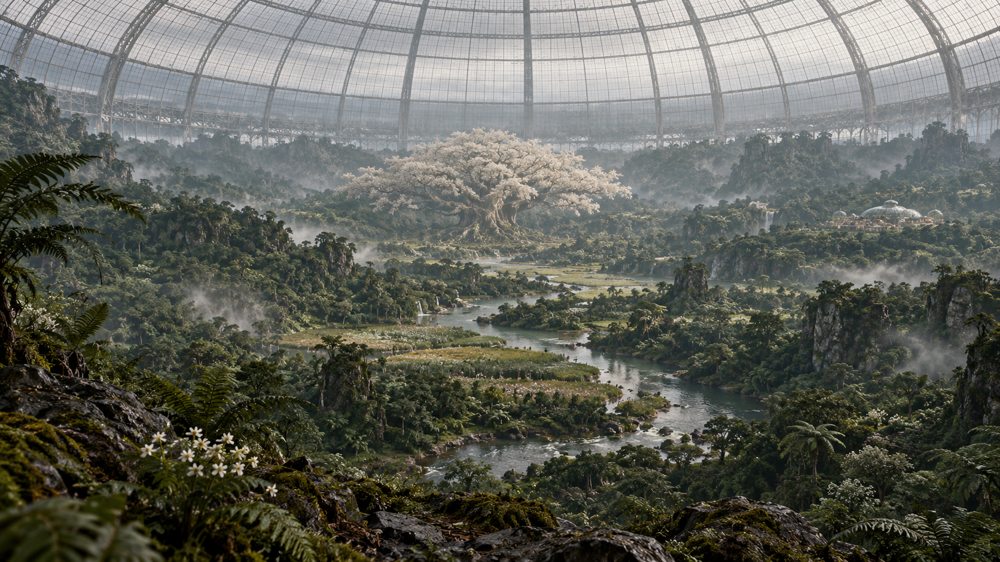
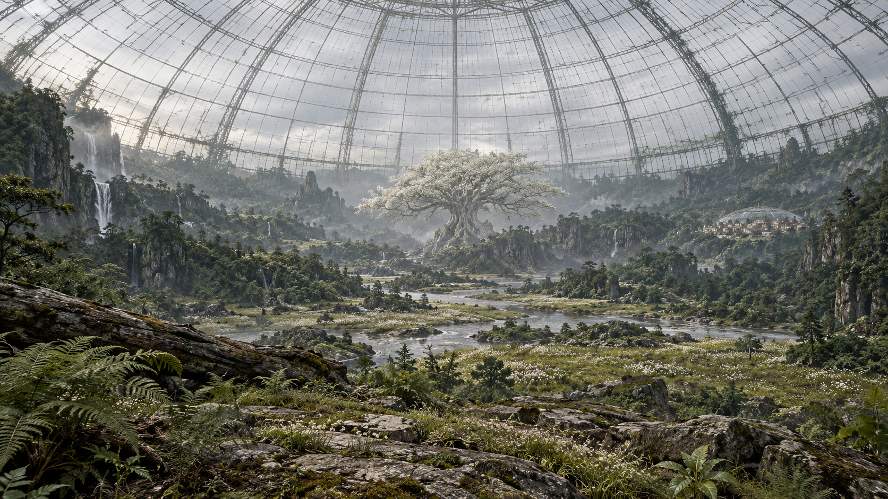
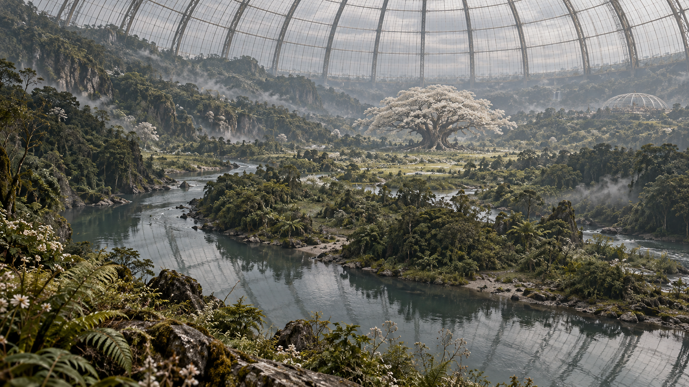
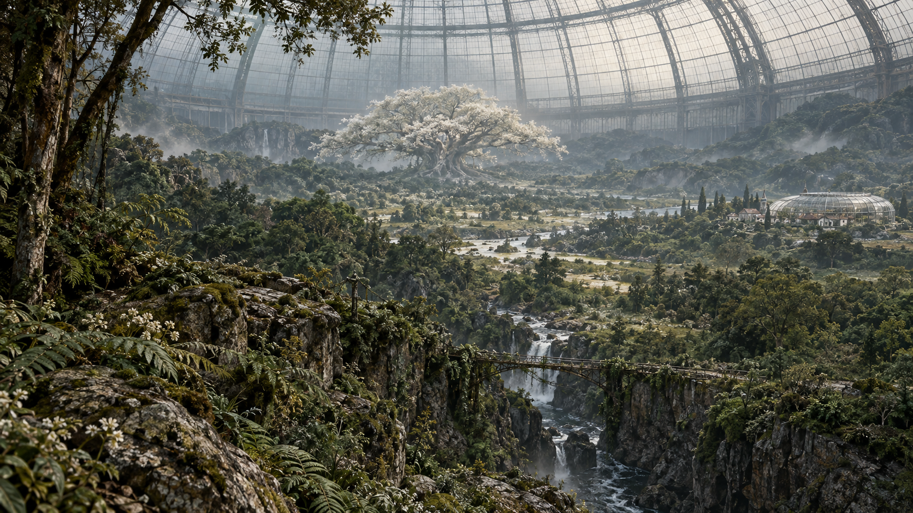
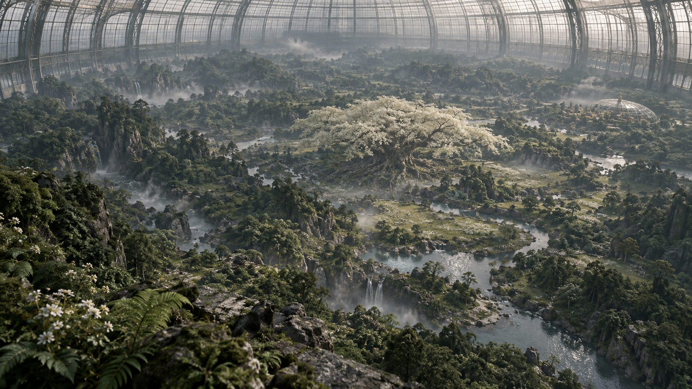

# ACT 1 SCENE 01｜巨大ガラスドーム・中央エリア全景 5案

2026-10-16（日本時間）。シーン内4〜8秒に使用するリファレンス候補。内蔵画像生成で5枚を新規生成。採用は未確定。PNG原寸1672×941px、指定画角16:9。モデルの内部名称はツールから提示されていない。

今回のユーザー指定：巨大ガラスドーム、荒野、植物、中央エリアの世界観をまず全景で示す。壮大な自然への畏怖を演出する。既存映画の特定場面を再現する指定にはしていない。

5枚は同一世界観の構図比較案。厳密な同一ロケーションの別アングルを実証したものではない。採用後は1枚を基準に地形・屋根・河川・母樹・町の配置を固定する。

| 案 | 管理ID | 構図 | 向いている用途 |
| --- | --- | --- | --- |
| 1 | IMG-010 | 丘上からの中央全景 | 冒頭4秒で中央の地理と広がりを伝える第一候補 |
| 2 | IMG-011 | 荒野と植生の広がり | 地面・岩場・草地の荒々しい感触 |
| 3 | IMG-012 | 水路から見渡す中央域 | 水面の反射と奥行き |
| 4 | IMG-013 | 岩稜越しの原生林全景 | 橋と谷を使った高さ・規模の比較 |
| 5 | IMG-014 | 高所俯瞰で示すドーム内部 | 中央の母樹と地形配置を俯瞰で把握 |

目視確認：5枚とも中央の母樹・広い植生・ガラス屋根が見え、字幕・パネル構成なし。4案目は小型温室の周囲に建物が見え、「町を小型温室内へ収める」過去の配置案との差分がある。4案目を採用する場合は建物の整理が必要。厳密な縮尺、町の収まり、リファレンス間の空間一致は未確定。

[使用プロンプト全文](../../image_prompts.md)は画像とともに保存。生成は静止画のみ。

## IMG-010｜丘上からの中央全景

## IMG-011｜荒野と植生の広がり

## IMG-012｜水路から見渡す中央域

## IMG-013｜岩稜越しの原生林全景

## IMG-014｜高所俯瞰で示すドーム内部

