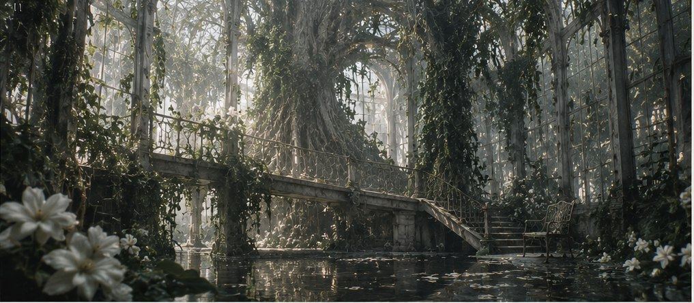
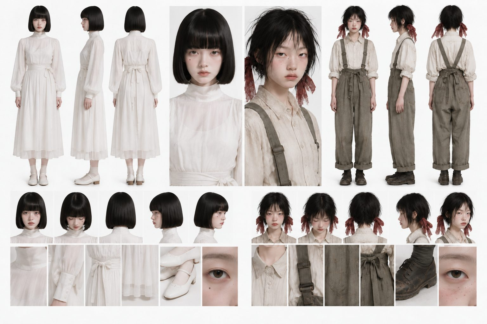

# 返り咲き

> 管理情報：添付資料「Final Report Ver 4.html」を Markdown 化した現在版です。初回保存日：2026-10-16（日本時間）。
> 原本：[Final Report Ver 4.html](sources/Final%20Report%20Ver%204.html)。本文は原本の内容を維持し、見出し・表・画面表示を Markdown に整形しています。
> 会話で確定した追加・変更はこのファイルに反映し、末尾の更新履歴に記録します。画像プロンプトは [image_prompts.md](image_prompts.md)、動画プロンプトは [video_prompts.md](video_prompts.md) で管理します。

**KAERIZAKI · 短編映画 最終脚本 Ver.4**

> 咲き直した命に、同じ過去はあるのか。

ジャンル・想定尺：ダークファンタジー / SFミステリー / サスペンス / クリーチャーホラー / 想定尺 6分55秒

**テーマ** 本物であることと、大切な存在であることは同じなのか。

**映像方針** 実写映画調・非言語中心・美しく残酷なバッドエンド。



*WORLD REFERENCE — 植物に覆われた巨大な温室と母樹*

---

## Ⅰ. 世界観設定

### 天国のように美しい、生物学的な地獄

舞台は巨大なガラス温室。外の世界は人間が従来の身体では生存しにくい環境となっており、かつて研究者たちは人類の生存可能性を広げる実験を始めた。その中心となるのが巨大な植物生命体「**母樹**」。

母樹は人間のゲノムを利用し、植物由来の性質を組み込んだ新たな身体を生み出す。研究者たちは、この複製工程を**「生命再構成」**と呼んだ。

母樹は元の人間の脳の情報も読み取り、複製体の脳に再構成する。さらに、複製体が新しい環境や人間関係に適応しやすいよう、記憶の一部を補正できる。**ゲノム編集と記憶の再構成は、母樹が行う一連の複製工程**である。

科学設定について：現実のゲノム編集だけで個人の記憶を再現できるわけではない。作中の記憶再構成は架空のSF技術として扱う。

### 「返り咲き」の正体

この世界では、死にかけた人間を母樹の白い花に寝かせると、数日後に元気な姿で戻ってくる。住民はその現象を「返り咲き」と呼び、祝福している。

しかし真実は異なる。母樹は元の人間を地下で生かしたまま保存し、ゲノム編集によって改変した複製体を地上へ送り出している。複製体は赤い根を通じて、地下の本物から生命力を受け取る。

複製体の根を切断すると、複製体への生命供給が止まり、奪われていた生命力が本物へ戻る。ただし、**複製体は枯れてしまう**。

### 色と生物の約束

| 要素 | 世界の役割 | 観客に最初に見える意味 |
| --- | --- | --- |
| 白い花 | 複製・返り咲きの装置 | 治癒と祝福 |
| 赤い根 | 生命力の供給路 | 不吉な植物 |
| 母樹 | 身体と記憶を再構成する中枢 | 神聖な大樹 |
| 星喰み | 改変生態系に属する小型キメラ | 不思議な友好的生物 |
| 剪定獣 | 根の切断を妨害する防衛生物 | 二人を襲う怪物 |

### 識別番号

| 表示 | 意味 |
| --- | --- |
| `0417` | ユナの元ゲノムの識別番号 |
| `Y-07` | 本編の主人公である複製ユナ |
| `Y-08` | 後から生成された別の複製個体 |
| `0608` | 返り咲きの儀式を受ける少年 |

同じ元ゲノムを持つ個体には同じ番号が付く。しかし、改変された身体や、実際に経験した時間まで同じとは限らない。

---

## Ⅱ. キャラクター設定



*CHARACTER REFERENCE — 左：ユナ ／ 右：ミオ ※制作上の外見基準*

### ユナ｜Y-07（16歳前後）

黒髪の整ったボブ、自然な前髪、**右頬に小さなほくろ**。シンプルな白いワンピースを着た、ほっそりした静かな少女。少し人形のような印象。

数か月前に事故に遭い、母樹の力で助かったと思っている。本当は母樹によって生成された複製体だが、本人は知らない。

**身体に現れる4つの違和感**

1. 地面を踏むと周囲の葉が開く。
2. 浅い傷から透明な樹液状の液体がにじむ。
3. 指の皮膚の下に葉脈状の模様が見える。
4. キメラ生物がユナにだけ反応する。

これらはすべて、母樹による意図的なゲノム編集の結果。

### ミオ｜親友（16歳前後）

短く少し乱れた黒髪に、細い赤いリボン。切れ長の一重まぶた、自然なそばかす。生成りのシャツに、くすんだオリーブ色の作業服。活発だが優しい。

ユナが事故に遭った際、彼女を母樹へ運んだ。帰ってきたユナと数か月間をともに過ごす。事故前のユナも、返り咲いたあとのユナも大切に思っている。

### 剪定獣｜母樹の防衛生物

鹿、昆虫、深海生物、花が融合したような大型キメラ。白く半透明の身体、異常な数の脚と関節。顔の中央に花のような器官があり、開くと内部の細い歯が露出する。**根を切ろうとする者を優先的に襲う**。悪意ではなく生態的な防衛行動。

### 二人だけの合図

**小指を重ね、そのあと親指を二度触れ合わせる。**

現在の二人は実際に何度もこの合図を交わしている。ただし、ユナが覚えている「幼い頃からの約束」という記憶の由来には秘密がある。

---

## Ⅲ. 構成タイムライン

| 章 | 時間 | 長さ | 主な出来事 |
| --- | --- | --- | --- |
| PROLOGUE | 0:00–0:24 | 24秒 | 白い研究所・グリッチ・指切り |
| ACT 1 | 0:24–1:40 | 76秒 | 美しい街・返り咲き・身体の伏線 |
| ACT 2 | 1:40–2:58 | 78秒 | ミオの襲撃・剪定獣・橋の崩落 |
| ACT 3 | 2:58–4:20 | 82秒 | 地下の繭・0417・ゲノム記録 |
| ACT 4 | 4:20–5:32 | 72秒 | 剪定獣との戦闘・記憶の真相 |
| ACT 5 | 5:32–6:36 | 64秒 | ユナの決断・消滅・指切りの不成立 |
| EPILOGUE | 6:36–6:55 | 19秒 | 研究所・Y-08 |

---

## PROLOGUE｜白い研究所 （0:00–0:24）

### SCENE 00-1｜問診 （0:00–0:07）

**INT. 白い研究所／時間不明**

真っ白な研究室。継ぎ目のない白い壁。中央には一脚の椅子。ユナが座っている。黒髪のボブ、白い服。右頬に小さなほくろ。

カメラは正面から固定されている。少女の顔はぼんやりしている。無機質な空調音。

画面外から、落ち着いた女性の声。

> 研究者（声）「どうされました？ 具合はどうですか」

ユナは答えない。瞬きもほとんどしない。わずかに呼吸が乱れる。

### SCENE 00-2｜視線 （0:07–0:09）

ユナの目元のクローズアップ。黒目が不自然に右へ動く。焦点が合わない。瞳の中に、一瞬だけ赤い光が映る。

### SCENE 00-3｜記憶の破片 （0:09–0:11）

突然のグリッチ。巨大なガラス温室、白い花、赤く脈動する根、異形のキメラ生物。巨大な剪定獣が画面に飛び込む。ガラスが砕ける。鋭いノイズ。

すべてが高速で切り替わる。

### SCENE 00-4｜否定 （0:11–0:17）

突然、白い研究所へ戻る。先ほどと完全に同じカメラ位置。

> 研究者（声）「どうされました？」

沈黙。ユナが視線を戻す。

> ユナ「……どうもしてないです」

その声にはほとんど抑揚がない。

### SCENE 00-5｜約束の断片 （0:17–0:21）

再び短いグリッチ。幼い少女たちの小指。指切り。一瞬だけ、手術灯。研究用手袋をした手が少女の指を動かしている。

その後、柔らかな光の中でユナとミオの小指が重なる。親指が二度触れる。短い子守歌のような旋律。

### SCENE 00-6｜タイトル （0:21–0:24）

黒画面。

返り咲き

音が途切れる。

---

## ACT 1｜美しい世界 （0:24–1:40）

### SCENE 01｜花の街 （0:24–0:45）

**EXT. 巨大温室都市／朝**

巨大なガラスドーム。その内部には森と街が広がっている。白い花が無数に咲き、透明な葉が光を反射する。古びた時計塔。植物に覆われた住居。水路と空中橋。

人々は穏やかに暮らしている。花畑の中を奇妙な動物が歩いている。鹿のような身体には六本の脚。半透明の小型生物が空中を漂う。その顔には、目の代わりに小さな花のつぼみが並んでいる。

美しいが、構造がどこかおかしい。しかし住民は気にしない。水路の先に巨大な白い母樹が見える。

### SCENE 02｜蘇生 （0:45–1:03）

**EXT. 母樹の祭壇／昼**

病弱な少年が巨大な白い花の上に横たわっている。手首には小さな識別札。「**0608**」。花弁が少年の身体を包み込む。

光が変化する。翌朝、花弁が再び開く。元気になった少年が立ち上がる。母親が抱きしめる。人々は祝福する。

しかし、その少年が歩き出したあと、石畳の隙間から赤い芽が生える。

### SCENE 03｜ユナの違和感 （1:03–1:25）

**EXT. 白い花の回廊／昼**

ユナとミオが並んで歩いている。ユナが石畳を踏む。足元の小さな葉がゆっくり開く。次にミオが踏む。何も起きない。ユナは気づいていない。

小さなキメラ「星喰み」が空中を漂っている。ミオが手を伸ばしても反応しない。しかし、ユナが手を差し出すと近づいてくる。

ユナが笑う。ミオも笑う。二人は小指を重ねる。親指を二度触れ合わせる。

指先のアップ。ユナの皮膚の下に、葉脈のような線が一瞬浮かぶ。ミオがその指を見る。微笑みがわずかに消える。

### SCENE 04｜最初の疑問 （1:25–1:40）

ミオは、以前見つけた古い管理用モニターを調べている。画面には地下施設の監視映像。透明な繭の中で眠る少年。手首には「0608」。先ほど元気になった少年と同じ番号。

別の画面には、赤い根に包まれた少女の腕。識別番号「**0417**」。ミオは画面を凝視する。

背後からユナが近づく。ユナの足元の葉が開く。ミオは振り返る。ユナの手首にも「0417」。

ミオの視線が床下に続く赤い根へ移る。机には園芸ばさみが置かれている。ミオがゆっくりと手を伸ばす。

---

## ACT 2｜裏切り （1:40–2:58）

### SCENE 05｜刃 （1:40–2:03）

**EXT. 温室の水路／夜**

ユナが一人、水路沿いを歩く。遠くで水滴が落ちる。背後から金属音。ユナが振り返る。ミオが立っている。手には園芸ばさみ。

ユナは微笑む。ミオは答えない。視線はユナの足元に向いている。そこには赤い根が絡みついている。

ミオが刃を構える。ユナが一歩近づく。突然、ミオがはさみを振り下ろす。ユナは飛び退く。刃が石畳へ突き刺さる。

ユナは怯える。ミオが手を伸ばす。ユナは逃げ出す。

### SCENE 06｜剪定獣 （2:03–2:37）

**EXT. 空中橋／夜**

ユナは蔦に覆われた橋を走る。背後からミオが追ってくる。ユナの腕が割れたガラスに触れる。小さな傷。傷から**透明な液体**がにじむ。ユナは袖で拭う。

その瞬間、橋の下から巨大な白い生物が現れる。剪定獣。長い首。六本の脚。花のような顔。花弁がゆっくり開く。内部には細い歯が並んでいる。

剪定獣は低い音を発する。一瞬の静寂。次の瞬間、激しく突進する。橋のガラスが砕ける。ユナが転倒する。

剪定獣はユナのすぐ横を通過し、はさみを持つミオへ向かう。ミオが身をかわす。怪物の脚が橋の支柱を破壊する。

### SCENE 07｜救出と落下 （2:37–2:58）

ユナが橋から滑り落ちる。鉄骨を片手でつかむ。ミオが駆け寄る。ユナは怯えて手を引こうとする。

しかしミオは園芸ばさみを捨て、ユナの腕をつかむ。必死に引き上げる。二人の目が合う。ミオは泣きそうな表情。

ユナは混乱する。殺そうとしたはずの親友が、なぜ自分を助けるのか。

その瞬間、剪定獣が再び突進する。橋が崩壊。二人は無数の蔦とともに地下へ落下する。暗転。

---

## ACT 3｜地下の真実 （2:58–4:20）

### SCENE 08｜眠る人々 （2:58–3:24）

**INT. 母樹地下施設／夜**

暗闇。水滴の音。ユナが目を覚ます。ミオが近くに倒れている。ユナは駆け寄り、彼女を起こす。

二人が周囲を見渡す。巨大な根が地下迷宮を作っている。奥には赤い光。光をたどって進むと広大な空間に出る。

天井から無数の透明な繭が垂れ下がっている。中には人間。子供、老人、若者。

ユナが一つの繭を覗き込む。中にいるのは、冒頭で蘇生した少年。腕には「0608」。しかし少年は病弱な姿のまま、眠っている。

ユナは理解できない。地上にいた少年と、ここにいる少年。同じ番号。同じ顔。

### SCENE 09｜もう一人の自分 （3:24–3:54）

ミオがユナを奥へ導く。巨大な白い繭。中には一人の少女が眠っている。

ユナ。同じ顔。同じ髪。同じ右頬のほくろ。

しかし、眠るユナの手首には事故の傷がある。主人公は自分の手首を見る。傷がない。両者の識別番号は「0417」。

ユナが一歩後退する。足元で葉が開く。肩に小型キメラが寄ってくる。指先の皮膚には葉脈のような線。傷口からは透明な液体。

今までの小さな異常が一つにつながる。自分は普通の人間ではない。

### SCENE 10｜ゲノム記録 （3:54–4:20）

壁面の古い研究装置が点灯する。画面には二重らせん。人間の身体図。植物的な構造が組み込まれた複製体の設計図。

```text
GENOME ID : 0417SUBJECT : Y-07GENOME EDIT : COMPLETE
```

人間の姿をした設計図が、植物の性質を持つ形へ変化していく。さらに、古い脳の画像が重なる。そこには再構成された神経情報の記録。

ユナは幼い頃の記憶を思い出す。ミオと指切りをする光景。しかし一瞬だけ映像が乱れ、白い研究室の手術灯が差し込まれる。ユナは戸惑う。まだすべては理解できない。

そのとき赤い根が光る。地下の本物から地上の複製ユナへ、生命力が流れている。本物の呼吸が弱くなる。

ユナは自分の足元の根を見つめる。ミオがそっと根を指さす。ユナは理解する。ミオが切ろうとしていたのは、この根だった。

---

## ACT 4｜生命の代償 （4:20–5:32）

### SCENE 11｜守る怪物 （4:20–4:43）

突然、地下が振動する。剪定獣が崩れた橋から伸びる根を伝って降りてくる。ミオが園芸ばさみを構える。怪物が反応する。

ミオが右へ動く。怪物も右を向く。ユナが横を通っても、怪物は動かない。

剪定獣が守っているのは、ユナにつながる赤い根。怪物は生命供給路を断つ者を排除するために存在している。

ミオが刃を構える。剪定獣が突進する。

### SCENE 12｜生命の逆流 （4:43–5:09）

ミオが攻撃をかわす。ユナが長い蔦をつかみ、怪物の脚へ絡ませる。剪定獣の身体が傾く。

ミオが露出した根へ向かう。刃を振り下ろす。一本の赤い供給路が切断される。

瞬間、根を流れる赤い光が逆流する。その先にある繭の中で、眠る人間の指が動く。呼吸が戻る。

一方、同じ根につながっていた**白い人型の蕾**が、花びらになって崩れ落ちる。

ユナがそれを見る。元の人間を救うことはできる。しかしそのためには複製体の命が失われる。ミオも初めて代償を理解する。二人は目を合わせる。

### SCENE 13｜記憶の記録 （5:09–5:32）

剪定獣は倒れた根に絡まり、動きを止める。二人は研究装置の前へ戻る。ユナは自分の記録を見つめる。

画面には脳の神経情報。幼少期の記憶が再生される。幼いユナとミオ。笑い合い、小指を重ねる。

しかし映像が乱れる。白い研究台。研究用手袋をした人物が少女の指を動かしている。小指を重ねる。親指を二度触れ合わせる。

ユナが息を呑む。記録の下部に新しい表示。

```text
MEMORY RECONSTRUCTION : COMPLETEFRIENDSHIP FORMATION : COMPLETE
```

ユナは画面を見つめたまま動かない。自分の身体だけでなく、過去の一部も作られていた。

ミオとの友情まで、誰かが設計した結果なのかもしれない。ただし、記録が示すのは友情の形成がプログラムされたという事実まで。二人が実際に過ごした数か月の感情が偽物だったかどうかは、記録からはわからない。

ユナはミオを見る。信じたい。しかしもう確かめることはできない。

---

## ACT 5｜返り咲き （5:32–6:36）

### SCENE 14｜自分の選択 （5:32–5:50）

本物のユナが眠る繭。呼吸はさらに弱くなっている。ユナはその身体へ伸びる赤い根を見る。

ミオは本物のユナの手を握っている。ユナはミオの涙を見る。そして自分の指先を見る。葉脈の模様。

自分にも痛みがある。生きたいという気持ちがある。それでもユナは園芸ばさみを拾う。

ミオが気づき、慌てて止めようとする。ユナは微笑む。小指を差し出す。ミオも重ねる。親指を二度触れ合わせる。ユナは静かに手を離す。

### SCENE 15｜最後の返り咲き （5:50–6:13）

ユナが自分の根に刃を当てる。刃先のアップ。金属音。根が切断される。

赤い光が逆流する。本物のユナへ生命力が戻っていく。複製ユナの指先が白い花びらへ変わり始める。

ミオが駆け寄り、抱きしめる。ユナの身体が静かに崩れていく。ミオは離そうとしない。

ユナは最後に小さく笑う。そして白い花びらになって消える。

一輪の白い花が残る。花弁には細い赤い筋。

### SCENE 16｜知らない約束 （6:13–6:36）

地下の繭が開く。本物のユナが目を覚ます。ミオが駆け寄り、抱きしめる。二人はしばらく、そのまま動かない。

場面転換。白い花の回廊。ミオと本物のユナが並んでいる。

ミオがいつものように小指を差し出す。本物のユナは戸惑う。何を求められているのかわからない。

ミオは彼女の手首を見る。そこには事故の傷。同じ顔。同じほくろ。同じ識別番号。しかし二人で過ごした数か月の時間は存在しない。

ミオはゆっくり小指を下ろす。

遠くでは新たな白い花のベッドが閉じている。今日も誰かが返り咲こうとしている。**世界は何も変わっていない。**

---

## EPILOGUE｜白い研究所 （6:36–6:55）

### SCENE 17｜次の少女 （6:36–6:55）

**INT. 白い研究所／本編の出来事の後**

冒頭とまったく同じ構図。白い壁。白い椅子。同じ顔の少女。黒髪のボブ、右頬のほくろ。

研究者の声。

> 研究者（声）「どうされました？」

少女は答えない。モニターが静かに点灯する。

```text
GENOME ID : 0417SUBJECT : Y-08
```

観客は気づく。ここにいるのは消えたY-07ではない。研究が生成した次の複製個体。

母樹はY-07の生前の神経情報を保存していた。その記録がY-08へ再構成されている。

冒頭の温室のフラッシュバックは、Y-08自身が体験した出来事ではなかった。**前の個体の記憶だった。**

少女の右肩に小さな葉が乗っている。少女がそれに目を向ける。葉の細い根が、服の下の皮膚へ伸びている。

少女の小指が、無意識にゆっくりと持ち上がる。誰もいない空間へ。しかし重ねる相手はいない。

白い研究所に、かすかな葉擦れの音が響く。

暗転。

END

---

## Ⅳ. 伏線と回収

| 序盤の描写 | 後半で判明する意味 |
| --- | --- |
| ユナが地面を踏むと葉が開く | 植物的に改変された身体 |
| キメラがユナだけに近づく | 母樹の改変生態系とのつながり |
| 透明な液体が傷からにじむ | 人間とは異なる生理機構 |
| 指先の葉脈 | 複製体の身体的特徴 |
| 蘇生した少年と地下の0608 | 同じ元ゲノムから作られた二人 |
| ユナと地下の0417 | 主人公も複製体だった |
| 剪定獣がミオを狙う | 根を切る行為を妨害する防衛機構 |
| 記憶に混ざる手術灯 | 記憶の再構成が行われていた |
| 指切りと手袋の同じ動き | 親密さの形成も実験の対象だった |
| 冒頭の研究所の少女 | Y-08がY-07の記録を受け取っていた |
| 肩に現れる葉 | 研究所の少女も植物的な改変個体 |
| 最後の指切りの不成立 | 身体を取り戻しても、共有した時間は戻らない |

---

## Ⅴ. 時間軸の真相

**過去：研究の始まり**

人間が従来の身体では生存しにくくなり、研究者が母樹の生命再構成技術を開発した。

**本編：Y-07の物語**

複製ユナがミオと暮らし、自分の正体を知り、本物を救うために消滅する。

**未来：Y-08の研究所**

母樹に保存されていたY-07の情報を利用し、後続個体Y-08が生成される。

映画冒頭の少女はY-08。その後の温室の本編は、彼女に移植された過去の個体の記録をもとに描かれる。エピローグは冒頭の研究所と同じ時間軸。この構成により、Y-07が消滅したあとに同じ顔の少女が登場しても矛盾しない。

---

## Ⅵ. 映像制作の絶対ルール

### 1｜美しさそのものがグロテスク

背景を恐ろしくしない。光、植物、水、建築は神聖なほど美しく。その中で生物の骨格や成長の仕方だけが不自然。怪物は腐敗した死体ではなく、異常な進化を遂げた美しい生命として描く。

### 2｜説明より観察

ユナが複製体であることを序盤に説明しない。葉の反応、傷口、キメラ、数字、身体の違和感を観客に観察させ、後半で別の意味を持たせる。

### 3｜ゲノム編集は科学的な核

ゲノム編集によって改変された身体と生態系を物語の中心にする。記憶の再構成は母樹の生命再構成工程の一部として扱い、別技術の説明を増やさない。

### 4｜アクションには意味を持たせる

剪定獣は単なる迫力のための怪物ではない。何を守り、誰を狙っているかが真相の手がかりになる。

### 5｜結末を慰めない

本物のユナを救えても、Y-07が消えた事実は変わらない。後続個体Y-08が生成され、研究は続く。情報を保存できても、一人の少女が自分の人生として過ごした時間を、そのまま取り戻せるわけではない。

---

## 最終テーマ

母樹は、人間の身体を作り直した。記憶も再構成した。友情さえも形成できるように設計した。

しかし、その結果として生まれた感情が本物なのかどうかは、誰にも証明できない。

そしてユナが消えても、研究は終わらない。新しいユナが同じ顔で、同じ記憶を思い出す。

> その記憶は本物なのか。それとも、誰かが作った人生なのか。

返り咲くたびに、別の命が生まれる。美しい世界は、今日も変わらない。

KAERIZAKI · END OF DOCUMENT

## 会話で確定した制作方針

### 画像プロンプトの共通冒頭文

すべての画像プロンプト本文の先頭に、[image_prompts.md の「必須の共通冒頭文」](image_prompts.md#必須の共通冒頭文) に保存したユーザー指定の英文全文を、改変・省略せず付けます。その後に各シーン固有の指示を続けます。会話での提示時・ファイル保存時ともに全文を含めます。

## 受領した過去の制作資料（2026-10-16）

添付された Markdown 12件の原本は [sources/README.md](sources/README.md) にまとめています。以下は原資料に記載された仕様と更新関係の記録です。資料の `draft` / `in_use` や AI の検収結果を、ユーザーの最終採用と同一視しません。脚本の物語・時間配分を変更する新しい指示は今回ないため、上の Ver.4 本文は維持します。

### ドームと町：制作資料に記載された空間仕様

出典：[A1 構造・縮尺 v3](sources/2026-10-16/dome_structure_scale_sheet.md)、[内観全景 v2](sources/2026-10-16/dome_overview_interior.md)、[町配置の編集](sources/2026-10-16/dome_interior_nested_town_edit.md)。

- 大ドーム：完全な半球、半径1km・直径2km・高さ1km。中心の白い母樹は高さ200mで、樹冠はドーム頂点へ届かず、高さの5分の1。
- 母樹の根は地下100mの空洞へ伸びる。母樹の横に幅約100mの裂け目があり、蔦に覆われた細い鉄とガラスの橋が1本架かる。
- 町は大ドーム内にある小型の古い鉄とガラスの温室へ収める入れ子構造。後続の配置編集では、温室外の家・時計塔・建物を除き、森林・花畑・水路へ戻すよう指定している。小型温室は1棟で、町の屋根や時計塔はその天井を突き抜けない。
- 大ドームの内周と外側は湿潤なジャングル。材質は古い暗色の錬鉄、緑青、曇った小さなガラス、苔、蔦、結露。遠い骨組みは細く霞み、近い屋根のスケールは町の小型温室にのみ用いる。
- **未承認の仮値（原メモの明示）**：町温室の高さ40m・直径250m、骨組み72本、研究室の中心から500mという位置、裂け目を母樹の横に置く案。研究室の埋設深さは未設定で、地下空洞と接続しない案も仮設定。骨組みの深さ約3m、横桁約50m間隔、ガラス約3m×4mも資料の設計値であり、最終承認は未確認。
- 外観全景は別の下書き。約4km先の高所からの固定画角と曇りの早朝は、[外観資料](sources/2026-10-16/dome_overview_exterior.md) に「AIが決めたこと（未承認）」と記載されている。

### 白い研究室：資料上は地下密閉室へ変更

出典：[旧10m壁案](sources/2026-10-16/white_lab_tall_walls_sheet_02.md) → [地下室 v2](sources/2026-10-16/white_lab_underground_sheet.md) → [整合性の編集](sources/2026-10-16/white_lab_underground_sheet_consistency_edit.md)。

地下室資料のメモには「ユーザー指定全文を使用」「旧10m壁・観察窓・ドームの案から地下密閉室へ変更」と記載されている。受領資料上の更新後の仕様は次のとおり。

- 地下の5m×5m、天井高3mの密閉室。窓・天窓・外への眺望はなく、閉じた扉が1枚。大ドームも空も見えず、地上に研究室の建物は現れない。
- 中央に椅子1脚、正面から見て右／平面図の東壁に小さな机と古い箱型モニター1台、反対の左／西壁に扉1枚。ベッドは置かない。
- 褪せた黄みのあるオフホワイトの壁紙、わずかな剥がれ・水染み、湿ったベージュのカーペット、吊り天井と蛍光灯パネル4枚。天井に小さな換気口とスピーカー。片隅の天井の継ぎ目から、短く枝分かれしない髪の毛ほど細い淡色の根が1本垂れる。
- 病的な黄緑色の蛍光灯、自然光なし。古い家庭用ビデオカメラの柔らかさ、低いダイナミックレンジ、薄いテープノイズと色にじみ。環境シートの写真は無人で、この指定は本編に人物を置かないという意味ではない。
- 整合性編集は寸法ラベルの重複除去、机・扉の配置統一、根を細く短くする修正。メモではAIによる検収とされ、人間の評価ではない。

旧案の10m白壁・開いた天井・観察窓・ベッド・ドームの眺望は、この地下室案へ混ぜない。Ver.4 本文の研究所は継ぎ目のない白壁として描かれているため、本文の美術描写まで地下室仕様へ差し替えるかは未確定として扱う。

### 母樹：白いAと茶色いBの比較資料

出典：[A：白い母樹](sources/2026-10-16/mother_tree_sheet_a_white.md)、[B：茶色い幹への編集](sources/2026-10-16/mother_tree_sheet_b_brown.md)。

- Aのメモには、母樹を「白い今の感じ／幹が茶色でシルエットは同じ」の2種類にするユーザー指示が記録されている。両資料とも `draft`。
- Aの案は幅広く低い傘状の樹冠、短く巨大な幹、岩盤を覆う板根。骨白から象牙色の木部、白い花、少数の細い赤い根、人が横たわれる白い花のベッドを含む。「今の感じ」を全景画像のシルエットと解釈したのはAIで、参照画像の採否は未記録。
- BはAの採用後、その出力画像を編集して木部だけを自然な茶色～灰褐色へ変える前提。シルエット・構図を維持し、白い花・花のベッド・赤い根を残す案だが、花の扱いは未確認とメモにある。
- A・Bの最終選択や実際の生成結果は今回の添付では確認できない。脚本の白い母樹を、Bが最終版であるとして変更しない。

### 検討中・未確定：旧カット資料と脚本との差分

出典：[線路の導入](sources/2026-10-16/yuna_railway_intro.md)、[傷跡がない手首](sources/2026-10-16/underground_wrist_no_scar.md)、[指切りと花びら](sources/2026-10-16/pinky_promise_petals.md)。

3件は2026-10-15作成の `draft`。元ジョブの指示を修正して取り込んだもので、生成では未確認と記載されている。対象モデルは未記録で、画像用・動画用も確認中。元の `s01_c01` / `s02_c01` / `s03_c01` は資料の cut_id として保持し、Ver.4 のシーン番号と自動対応させない。

| 論点 | 旧カット資料の記述 | 現在の Ver.4 との関係 |
| --- | --- | --- |
| 導入 | 温室内の線路の端でユナが立ち止まる | 現行の冒頭は白い研究所。線路のカットを挿入・置換する指示は未確定 |
| 衣装 | 二人とも園芸エプロン。ユナはリネンの服 | 現行はユナの白いワンピース、ミオの生成りシャツ・オリーブ色の作業服。衣装変更は未確定 |
| 手首 | ミオがユナの手首を握り、傷跡がないことを見せる。台詞「どうして、わたしにはないの？」 | 傷跡の有無は SCENE 09 と共通だが、握る動作・台詞を本文へ加えるかは未確定 |
| 指切り | 根を切ったあと、花びらへ変わりながら二人が指切りする引きの画 | 現行 SCENE 14 は切断前の指切り、SCENE 15 は抱擁と消滅。時点と演出の変更は未確定 |
| キャラクター参照 | ユナの確定シートは未決定と原メモにある | 現行には確定キャラクター設定画が保存済み。旧メモを現在の未決定事項に戻さない |

旧資料の `style_rules`、参照画像、元ジョブ、生成結果画像自体は今回未添付。脚本との差分はここへ保持し、採用されたものだけ本文へ反映する。

## 更新履歴

| 日付（日本時間） | 内容 | 出典 |
| --- | --- | --- |
| 2026-10-16 | 最終脚本 Ver.4 の世界観、人物設定、全23シーン、構成、伏線、時間軸、演出方針、最終テーマを初回保存。参考画像と原本も保存。 | 添付「Final Report Ver 4.html」 |
| 2026-10-16 | 画像プロンプトの先頭に必須で付ける共通英文を `image_prompts.md` に原文のまま保存し、提示・保存時に毎回全文を付ける制作方針を追加。 | ユーザーの会話指示 |
| 2026-10-16 | 過去の制作 Markdown 12件を原本保存。画像用9件を集約し、用途未確認のカット3件を索引化。ドームの縮尺・入れ子の町・地下研究室への資料上の変更・母樹A/Bと、未承認値・旧カットの脚本差分を記録。Ver.4 の脚本本文は維持。 | ユーザー「これまでのmdです。」添付12件（[資料索引](sources/README.md)） |
